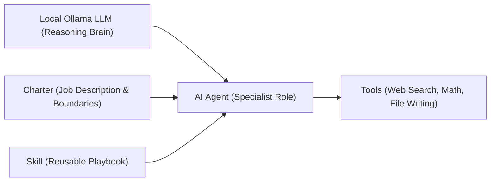
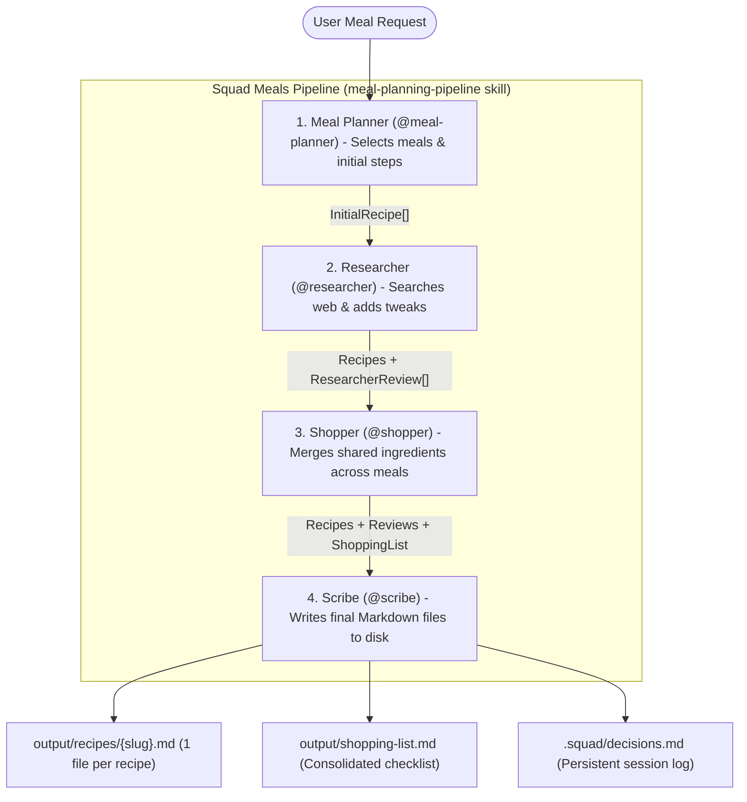

# Agents and Skills in Squad Meals

This guide explains how **AI Agents** and **Skills** work—starting with a plain-language introduction for general readers, followed by a detailed breakdown of the specific agents, skills, tools, and workflows that power **Squad Meals** (`squad-meals`).

---

## Part 1: General Background (For a General Audience)

### What Is an AI Agent?

When most people use an AI chatbot, they interact with a single generalist assistant: you type a complex request, and one AI tries to juggle every part of the job at once. While that works for quick questions, complex multi-step tasks often suffer when a single prompt has to brainstorm, fact-check, do math, and format documents all at the same time.

An **AI Agent** takes a different approach. Instead of one AI doing everything, an agent is a **specialized digital teammate** given:

1. **A focused role and identity** (who it is and what perspective it brings).
2. **A clear mission and set of boundaries** (what it *is* responsible for—and just as importantly, what it should leave to others).
3. **A reasoning engine** (an underlying Large Language Model—in our project, a private model running locally on your computer through **Ollama**).
4. **Tools** (specific actions it can take in the real world, such as searching the web or saving a file).

#### A Kitchen Analogy
Imagine running a busy restaurant kitchen:
- Rather than asking one overwhelmed person to invent tonight's menu, test the recipes, count every onion in the pantry, and print the menus simultaneously, a kitchen relies on **specialists**: an *Executive Chef*, a *Test-Kitchen Researcher*, a *Purchasing Manager*, and a *Menu Editor*.
- Each specialist focuses on doing one stage exceptionally well and hands their finished work to the next teammate.

Working with a **multi-agent team** ("squad") offers three major advantages:
- **Higher Quality through Focus:** Each agent gets tailored instructions for a single job, reducing mistakes and forgotten details.
- **Built-in Peer Review:** One agent can double-check and refine another agent's output before you ever have to step in.
- **Transparency:** Instead of waiting on a "black box," you can watch each specialist think, hand off work, and report status in real time.

---

### What Is a Skill?

If an **Agent** is *who* performs the work, a **Skill** is *the repeatable playbook or know-how* used to get a job done reliably.

In everyday life, a human chef might learn skills like *"weeknight menu balancing"* or *"sauce emulsification."* In an AI agent system, a **Skill** is a structured, reusable package of instructions, domain patterns, and workflow rules that teaches an agent (or an entire team of agents) how to execute a process consistently.

Skills matter because:
- **Consistency:** Agents follow a proven sequence rather than improvising from scratch on every run.
- **Reusability:** Skills are documented once and can be shared, refined, or reused across future tasks.
- **Clarity:** Anyone reading the project can inspect a skill to understand *how* the AI team approaches its domain.

---

### How All the Pieces Fit Together

In modern agent frameworks like **[`bradygaster/squad`](https://github.com/bradygaster/squad)**, five core concepts work together:

| Concept | Everyday Analogy | Role in the System |
| :--- | :--- | :--- |
| **LLM (Ollama)** | **The Brain** | The language model running on your computer that powers reading, reasoning, and writing. |
| **Agent** | **The Specialist** | A named team member with a distinct role (e.g., Researcher or Shopper). |
| **Charter** | **The Job Description** | A document defining an agent's mission, responsibilities, voice, and strict boundaries. |
| **Skill** | **The Playbook / SOP** | Reusable domain knowledge or workflow instructions guiding how tasks are carried out. |
| **Tool** | **The Hands / Equipment** | Concrete actions an agent can trigger, such as searching online recipes or writing Markdown files. |

---

## Part 2: How Squad Meals Organizes Its Team

Squad Meals is built on the **`@bradygaster/squad-sdk`** framework and uses a **repository-native** design. That means the AI team isn't hidden away in a cloud dashboard—every team member, rule, and memory log lives right inside this project folder:

1. **Human-Readable Team Handbook (`.squad/`):**
   - [`.squad/team.md`](../.squad/team.md) — The active team roster listing every specialist.
   - [`.squad/routing.md`](../.squad/routing.md) — Dispatch rules explaining which agent handles each stage of work.
   - [`.squad/agents/*/charter.md`](../.squad/agents/) — Individual job charters loaded into each agent's prompt so it stays in character and on task.
   - [`.squad/decisions.md`](../.squad/decisions.md) — Shared team memory log where completed meal-planning runs and architectural choices are recorded across sessions.
2. **Programmatic SDK Configuration ([`squad.config.ts`](../squad.config.ts)):**
   - Uses `@bradygaster/squad-sdk` builders (`defineSquad`, `defineTeam`, `defineAgent`, `defineSkill`, `defineRouting`, and `defineHooks`) to wire the roster, skills, capabilities, and file-safety rules into TypeScript.
3. **Pipeline Coordinator ([`src/squad-engine.ts`](../src/squad-engine.ts)) & Live TUI ([`src/tui.ts`](../src/tui.ts)):**
   - Coordinates agent handoffs over the Squad `RuntimeEventBus` while animating each agent's ASCII character and live feedback panel in your terminal.

### End-to-End Collaboration Flow

---

## Part 3: Specific Agents Used in Squad Meals

Squad Meals employs **four specialized agents** that collaborate sequentially on every prompt. In the Terminal User Interface (TUI), each agent is represented by its own ASCII avatar that animates whenever that agent is actively working.

---

### 1. Meal Planner (`@meal-planner`)
- **Role Title:** Executive Chef & Recipe Architect
- **Charter File:** [`.squad/agents/meal-planner/charter.md`](../.squad/agents/meal-planner/charter.md)
- **TUI Avatar Persona:** Chef wearing a *toque blanche* (chef's hat)
- **Declared Capabilities:** `recipe-conception` *(Expert)*, `menu-planning` *(Expert)*
- **Assigned Tool:** `propose_recipes`

#### What Meal Planner Does
Meal Planner is the first agent to read your prompt. It evaluates your dietary restrictions (e.g., *"no dairy"*, *"no cream sauces"*), available ingredients, serving sizes, and desired number of meals (defaulting to 2–3 cohesive meals if you don't specify an exact number).

Crucially, Meal Planner intentionally chooses recipes that **share overlapping fresh ingredients** (such as garlic, herbs, lemons, or spinach) where practical so you don't end up buying dozens of half-used items at the grocery store.

#### Output Handed to the Squad
A structured list of `InitialRecipe` objects containing:
- Recipe title, URL-safe slug, and appetizing summary
- Prep time, cook time, and serving count
- Exact initial ingredient list (quantity, unit, preparation notes, and grocery category)
- Ordered, step-by-step cooking instructions

#### Strict Boundaries
Meal Planner **does not** browse the internet, consolidate cross-recipe grocery math, or write files to disk—those responsibilities belong to downstream teammates.

---

### 2. Researcher (`@researcher`)
- **Role Title:** Culinary Web Researcher & Recipe Critic
- **Charter File:** [`.squad/agents/researcher/charter.md`](../.squad/agents/researcher/charter.md)
- **TUI Avatar Persona:** Culinary detective/scholar with a magnifying glass
- **Declared Capabilities:** `web-verification` *(Expert)*, `review-analysis` *(Expert)*
- **Assigned Tools:** `web_recipe_search`, `annotate_recipe_tweaks`

#### What Researcher Does
AI language models can occasionally invent unusual spice ratios or skip helpful kitchen techniques when drafting from memory alone. **Researcher** acts as the squad's quality-control critic:

1. **Searches the Web (`web_recipe_search`):** For each dish proposed by Meal Planner, Researcher calls `searchWebForRecipe` ([`src/web-search.ts`](../src/web-search.ts)), querying **TheMealDB**'s community recipe database and **DuckDuckGo** web results for comparable recipes, ratings, and home-cook comments.
2. **Evaluates Similarity & Community Reviews:** Using local Ollama reasoning, Researcher compares Meal Planner's draft against real online recipes and reviewer tips (such as blooming spices in oil first, avoiding crowded pans, resting proteins, or brightening rich dishes with fresh lemon/acid at the end).
3. **Adds Tweaks & Adjustments (`annotate_recipe_tweaks`):** Marks each recipe as either **`Verified Solid`** or **`Tweaks Recommended`**, attaches concrete chef notes, cites the web URLs consulted, and optionally adds `ingredientAdjustments` if a classic ingredient or finishing touch was missing.

#### Strict Boundaries
Researcher **never throws away** Meal Planner's core meal selection unless it is fundamentally broken; instead, it enriches each recipe with transparent verification notes and actionable improvements.

---

### 3. Shopper (`@shopper`)
- **Role Title:** Grocery Logistics & Ingredient Consolidator
- **Charter File:** [`.squad/agents/shopper/charter.md`](../.squad/agents/shopper/charter.md)
- **TUI Avatar Persona:** Smart shopper pushing a market basket
- **Declared Capabilities:** `ingredient-consolidation` *(Expert)*, `unit-normalization` *(Proficient)*
- **Assigned Tool:** `consolidate_shopping_list`

#### What Shopper Does
Once the recipes and Researcher's ingredient tweaks are finalized, **Shopper** turns multiple separate ingredient lists into a single, practical grocery run:

1. **Gathers Every Needed Ingredient:** Pulls all base ingredients from `@meal-planner` plus any extra `ingredientAdjustments` added by `@researcher`.
2. **Consolidates Duplicates Across Recipes:** Uses a hybrid of deterministic unit/name normalization (`mergeAndConsolidateIngredients` in [`src/squad-engine.ts`](../src/squad-engine.ts)) and Ollama reasoning so shared ingredients are combined into **one single line item**. For example, if Recipe A needs `2 cloves garlic` and Recipe B needs `4 cloves garlic`, Shopper merges them into `6 cloves Garlic` and tags both recipes.
3. **Organizes by Grocery Store Section:** Groups items into intuitive aisles (`Produce`, `Meat, Poultry & Protein`, `Dairy & Eggs`, `Spices & Seasonings`, and `Pantry & Dry Goods`) so you don't have to backtrack through the store.

#### Strict Boundaries
Shopper **never** lists the same ingredient twice as separate rows when quantities can be combined, and it leaves file formatting/saving to `@scribe`.

---

### 4. Scribe (`@scribe`)
- **Role Title:** Culinary Technical Writer & Markdown Archivist
- **Charter File:** [`.squad/agents/scribe/charter.md`](../.squad/agents/scribe/charter.md)
- **TUI Avatar Persona:** Archivist writing with a quill on a Markdown scroll
- **Declared Capabilities:** `markdown-documentation` *(Expert)*, `recipe-publishing` *(Expert)*
- **Assigned Tools:** `write_recipe_markdown`, `write_shopping_list_markdown`

#### What Scribe Does
**Scribe** is the final stage of the pipeline and the only agent that publishes deliverables to your `output/` directory:

1. **Writes One Separate Markdown File Per Recipe (`output/recipes/<slug>.md`):**
   - Includes prep/cook times, servings, `@meal-planner`'s ingredients and numbered steps, `@researcher`'s ingredient adjustments, verification status, community review consensus, recommended tweaks, clickable source links, and a link back to the master shopping list.
2. **Writes One Consolidated Shopping List File (`output/shopping-list.md`):**
   - Links to every individual recipe Markdown file created during the run and renders `@shopper`'s merged grocery items as interactive Markdown checkboxes (`- [ ]`) organized by aisle, noting which meal(s) use each item.
3. **Updates Persistent Squad Memory (`.squad/decisions.md`):**
   - Appends a timestamped session summary recording your prompt, the Ollama model used, the meals planned, and every file path written.

#### Strict Boundaries & Safety Hooks
Through Squad's governance hooks (`defineHooks` in [`squad.config.ts`](../squad.config.ts)), file writing is explicitly scoped to `output/**` and `.squad/**`.

---

## Part 4: Skills, Capabilities, and Routing in Squad Meals

### Project Skill: `meal-planning-pipeline`

In [`squad.config.ts`](../squad.config.ts), Squad Meals defines a team-wide orchestration skill using `defineSkill`:

| Property | Value | Meaning |
| :--- | :--- | :--- |
| **Skill Name** | `meal-planning-pipeline` | Unique identifier for the squad's core workflow skill. |
| **Domain** | `culinary-orchestration` | Problem domain covered by this skill. |
| **Confidence** | `high` | Indicates a well-established, deterministic team workflow. |
| **Source** | `manual` | Authored directly by the project maintainers in `squad.config.ts`. |
| **Workflow Pattern** | 4-Stage Sequential Handoff | `1. Meal Planner drafts recipes` → `2. Researcher verifies online & adds tweaks` → `3. Shopper consolidates ingredients` → `4. Scribe writes 1 MD per recipe + 1 shopping list MD`. |

---

### Summary Matrix: Agents, Capabilities, Tools, and Routing

The table below summarizes how Squad Meals maps routing patterns, capabilities, and tools across its four specialists:

| Stage | Agent (`Handle`) | Routing Pattern | Capabilities (`Level`) | Tools | Primary Output |
| :--- | :--- | :--- | :--- | :--- | :--- |
| **1** | **Meal Planner** (`@meal-planner`) | `plan-*` *(Default)* | `recipe-conception` *(Expert)* `menu-planning` *(Expert)* | `propose_recipes` | Initial recipes, ingredient lists & cooking instructions |
| **2** | **Researcher** (`@researcher`) | `research-*` | `web-verification` *(Expert)* `review-analysis` *(Expert)* | `web_recipe_search` `annotate_recipe_tweaks` | Online verification status, reviewer consensus, recipe tweaks & sources |
| **3** | **Shopper** (`@shopper`) | `shop-*` | `ingredient-consolidation` *(Expert)* `unit-normalization` *(Proficient)* | `consolidate_shopping_list` | Deduplicated, aisle-sorted grocery list with combined quantities |
| **4** | **Scribe** (`@scribe`) | `write-*` | `markdown-documentation` *(Expert)* `recipe-publishing` *(Expert)* | `write_recipe_markdown` `write_shopping_list_markdown` | `output/recipes/<slug>.md` (per recipe) + `output/shopping-list.md` + `.squad/decisions.md` log |

---

### Customizing or Extending Agents and Skills

Because Squad Meals uses repository-native files, customizing your culinary team is straightforward:

- **Adjust an Agent's Personality or Culinary Rules:** Edit the Markdown charter inside `.squad/agents/<agent-name>/charter.md` (for example, instructing `@meal-planner` to always prioritize high-protein meals or 30-minute prep times). Changes take effect immediately on the next run.
- **Add New Skills or Agents:** Register new skills with `defineSkill(...)` or additional agents (such as a `@nutritionist` macro-calculator or `@sommelier` beverage pairing specialist) in [`squad.config.ts`](../squad.config.ts) and add their corresponding charter under `.squad/agents/`.
